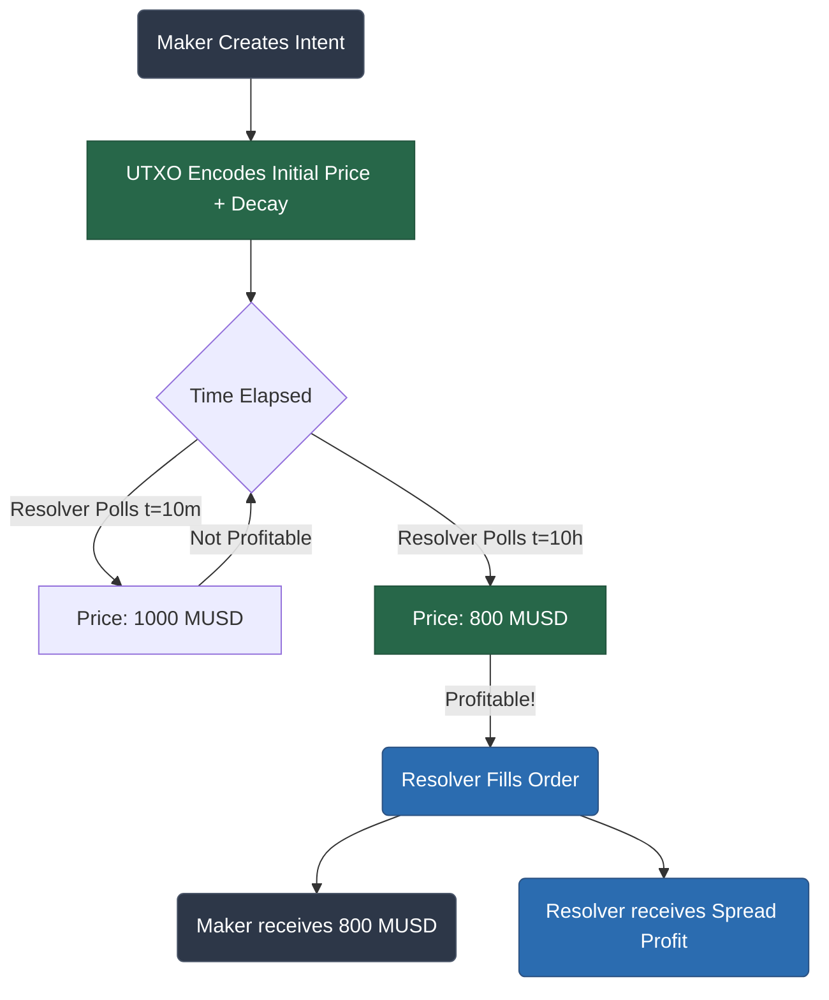

# Intents-Swaps: Same-Chain CashToken Smart Contracts

[](../docs/reviewers-guide/01-protocol-overview.md)
[](#license)

This repository contains **Bitcoin Cash (BCH) smart contracts** enabling pure, decentralized Same-Chain Swaps.

Unlike Cross-Chain HTLCs, these contracts function entirely natively on the Bitcoin Cash network. They utilize the CashToken upgrade and Introspection opcodes to facilitate intricate trades directly on the UTXO ledger (e.g., swapping native BCH for `MUSD`).

### Related Repositories
This is part of the Same-Chain CashToken infrastructure. It works directly in tandem with:
* **[cashtoken-relayer](../cashtoken-relayer)**: The off-chain Node.js Decentralized Resolver that acts as an arbitrage bot to fill these covenants.

## Architecture: Covenants vs AMMs

These contracts use **Recursive Covenants** and **Introspection Opcodes**. Instead of relying on passive liquidity pools (AMMs), Users encode their exact order criteria into a UTXO. Resolvers (via the relayers) match these orders against available market liquidity.

### 1. Limit Orders (`Swap.cash`)
Allows a user to lock assets (BCH or a specific CashToken) into a UTXO covenant. The covenant enforces a strict execution price. A Resolver can only spend this UTXO if the spending transaction simultaneously creates an output paying the User the exact requested amount.

Limit Orders also support maker-initiated early cancellation (`cancelEarly()`) — the maker can reclaim their funds at any time, not just after expiry. See [`docs/limit-order-early-cancel.md`](docs/limit-order-early-cancel.md) for the design and security test coverage.

### 2. Dutch Auctions (`DutchAuction.cash`)

Dutch Auctions require continuous state tracking (price vs time). Unlike Ethereum, Bitcoin Cash has no mutable storage. We use Recursive Covenants to track a decaying price curve.



## Introspection Magic (How It Works)

CashScript compiles to BCH's native introspection opcodes (`OP_TXLOCKTIME`, `OP_OUTPUTBYTECODE`, `OP_OUTPUTTOKENAMOUNT`, etc.). These let the covenant inspect the spending transaction to enforce rules entirely on-chain without oracles.

*   `tx.locktime`: The covenant reads current time for the Dutch Auction price decay curve.
*   `tx.outputs[].tokenCategory`: Verifies WHAT token the user is paid (e.g., MUSD).
*   `tx.outputs[].tokenAmount`: Verifies EXACTLY HOW MUCH the user receives based on the curve.

If the Resolver constructs an invalid payload (e.g., taking the BCH without giving the MUSD), the transaction fails at the hardware level.

## 🛠️ Installation & Testing

1. **Install Dependencies**
   ```bash
   npm install
   ```

2. **Run the Test Suite**
   We use `cashscript` alongside `ElectrumNetworkProvider` to run tests locally against Chipnet.
   ```bash
   npm test
   ```

Our test suite validates:
* Compilation & Instantiation
* Dutch Auction Math (Linear Decay correctness)
* Address Determinism
* Full Swap Lifecycle (End-to-End)

## Future-Proofing (2026 Upgrades)

While the current MVP successfully utilizes 2023 Introspection to execute linear logic, building advanced DeFi requires iterative mathematics. **Update (2026-07-04): the "Layla" network upgrade — which shipped Bounded Loops (`OP_BEGIN`/`OP_UNTIL`), Pay-to-Script, Functions (`OP_DEFINE`/`OP_INVOKE`), and Bitwise operations — activated 2026-05-15. This is no longer an "upcoming" upgrade; it's live on mainnet today.**

Currently, Dutch Auction pricing is still constrained to linear decay in the deployed contracts. Bounded loops (now available) would allow non-linear execution — such as advanced AMM models or exponential time-decay curves — directly on-chain using iterative approximations (like Taylor series) within these covenants. They're also the key enabling primitive for on-chain partial fills and TWAP tranching — see `cashtoken-relayer/docs/future/03-partial-order-fills.md` and `04-twap-orders.md` for concrete designs now that these opcodes are actually available.

---

## 📜 License

**Copyright (c) 2026 Intents-Swaps. All Rights Reserved.**
This software and associated documentation files are proprietary and confidential. No part of this repository may be copied, reproduced, distributed, or modified without explicit written permission.

*Part of the Intents Swap Protocol Ecosystem — Bringing Intent-based DeFi to Bitcoin Cash.*
